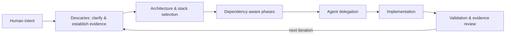

# Descartes

*cogito, ergo sum*

### AI Engineering Architecture & Multi-Agent Orchestration

Turn human product intent into grounded technical decisions, phased plans, coordinated agent work, and evidence-based review.

Descartes is a vendor-neutral engineering architecture skill. A human owns product vision and final decisions; Descartes helps reason about how to deliver them. Its name recalls René Descartes’ philosophical phrase *cogito, ergo sum* (“I think, therefore I am”); the software methodology is our own and does not imply his endorsement.

## How it works

## Capabilities

- Architecture and technology selection by subsystem, with tradeoffs.
- Incremental phases, dependencies, migration planning, and preservation of existing behavior.
- Multi-agent task ownership, stable contracts, safe parallelism, and integration planning.
- Execution-ready prompts, effort allocation, validation gates, and implementation report review.

## Install

The repository contains a portable `SKILL.md` and its prompt reference. For a skill-capable agent, follow that platform’s documented skill installation mechanism and place both files in the configured skill directory (preserving `references/`). No platform-specific installer is claimed or required. Manual use: provide `SKILL.md` as the working instructions and consult `references/prompt-template.md` when producing an execution prompt.

## Quick start

Ask: “Plan a subscription SaaS for small clinics. We have an existing API and need patient scheduling, staff access, and auditability. Inspect the repository before recommending a stack. Give me phases and an execution prompt.”

Descartes should first separate verified repository facts from assumptions, then recommend subsystem boundaries and technology with rationale, sequence work by dependencies, and define acceptance checks. Its generated prompt is based on [`references/prompt-template.md`](references/prompt-template.md).

## Multi-agent architecture

Use one accountable orchestrator and the minimum useful specialists. Define inputs, outputs, and exclusive write ownership; stabilize shared interfaces before parallel work; serialize shared files and integration. Schedule by dependencies and validate assembled work centrally. More agents add coordination cost and are not automatically faster.

## Examples

- [Web application](examples/web-application.md) · [Desktop migration](examples/desktop-migration.md)
- [Enterprise system](examples/enterprise-system.md) · [Agent workflow](examples/agent-workflow.md)

## Documentation

[Introduction](docs/introduction.md) · [Philosophy](docs/philosophy.md) · [Architecture](docs/architecture.md) · [Workflow](docs/workflow.md) · [Multi-agent orchestration](docs/multi-agent-orchestration.md) · [Technology selection](docs/technology-selection.md) · [Installation](docs/installation.md) · [Examples](docs/examples.md)

## Contributing and security

See [CONTRIBUTING.md](CONTRIBUTING.md) and [SECURITY.md](SECURITY.md). Please report vulnerabilities privately using GitHub’s security reporting feature when enabled; otherwise contact repository maintainers through GitHub.

## License

MIT. See [LICENSE](LICENSE).
